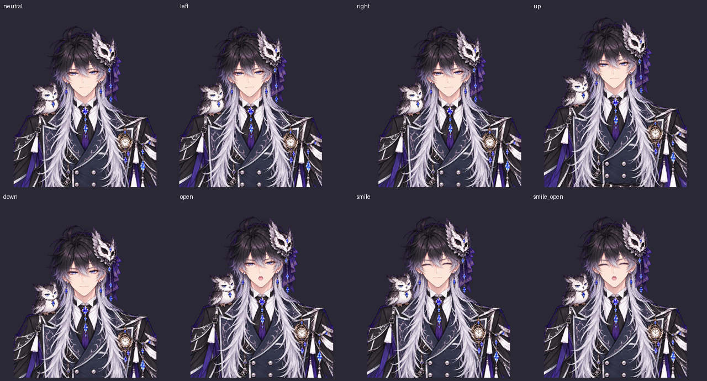

# 移動・口・笑顔の操作

| 操作 | 仕様 |
|---|---|
| 頭の回転 | 左右・かしげ ±5°、上 +5°／下 −10°（変更なし） |
| 体の横・縦移動 | 回転とは独立。元絵の座標で横 ±90px、縦 ±70px。顔・耳・髪・体は一緒に移動 |
| 口 | 閉じ口か、参考画像 A の開いた口。I/U/E/O を混ぜない |
| 笑顔 | 初期状態は真顔。1で笑顔切替、0で真顔。ボタンも使用可 |
| 笑顔時の口 | 笑い目のみを切替。口は引き続き閉じ口／A の2形状 |



画像は上段が真顔・左移動・右移動・上移動、下段が下移動・Aの口・笑顔・笑顔とAの口。移動方向を示すため、回転を0に固定して撮影した。

## 試し方

`dist/owl_prince.html` を GitHub の「Download raw file」で保存し、Chrome で開く。スライダーの「体の横移動」「体の縦移動」、またはマウス追従で動かせる。上下移動で頭が切れにくい表示余白を設け、胴体の下端は画面の下に続く構図にしている。

笑顔はビューアにフォーカスしてキー1、もう一度1で解除、0でも真顔に戻る。文字入力中やキーの長押しでは切り替えない。カメラが笑顔のパラメータを上書きすることはない。

カメラは顔の向きと位置を別々に測る。「正面を較正」で両方の中心を合わせる。「移動の感度」は位置の移動だけに作用し、回転の感度とは別。口は顎の開きが0.18以上で開き、0.10未満で閉じる。境界付近で開閉がちらつかないようにし、形状の中間フェードは行わない。

## 検証

リポジトリルートで、ビルドとHTML出力の後に実行する。

```sh
python -m live2d_ai build projects/owl_prince
python -m live2d_ai export projects/owl_prince -o dist/owl_prince.html
node --test tests/tracking.test.cjs
CHROME_PATH=/usr/bin/chromium python -m unittest discover -s tests -v
```

このクラウドでは Python は `/workspace/.venvs/live2d/bin/python`。検証結果は Node 7件、Python 6件、すべて成功。Pythonのうち2件は実ブラウザでビューアと出力HTMLを操作し、全パーツの共通移動、回転の独立性、口の2形状、笑顔キー・ボタン・リセット・入力欄での誤操作防止、マウス追従を確認する。検出結果を模した入力で顔位置と回転の分離、開閉の閾値、手動表情の維持も確認する。

静止 PSNR は full 34.42 / face 34.39 / eyes 32.68 dBで前の切り取り修正版から変化なし。実機のWebカメラによる反応速度や使いやすさは手元での確認が必要。
