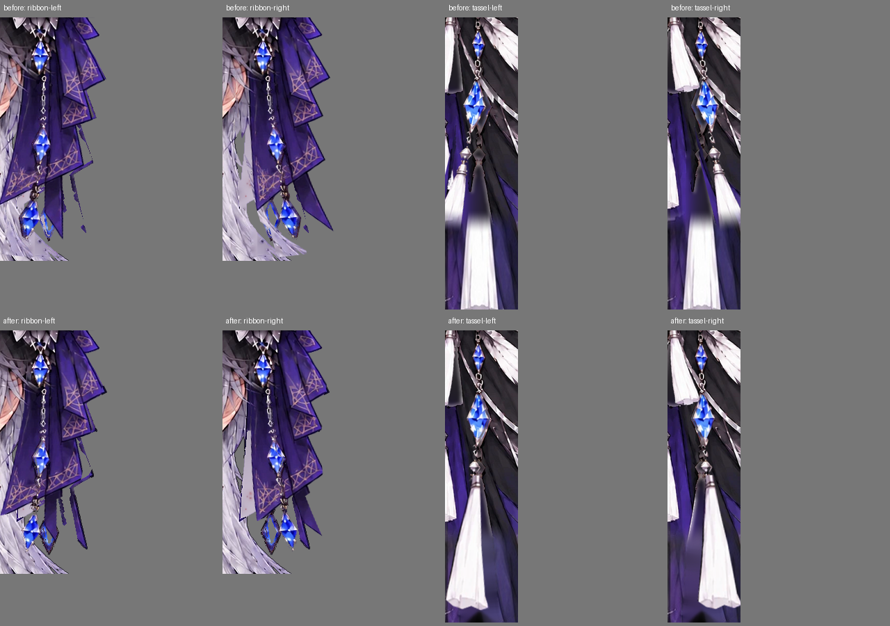
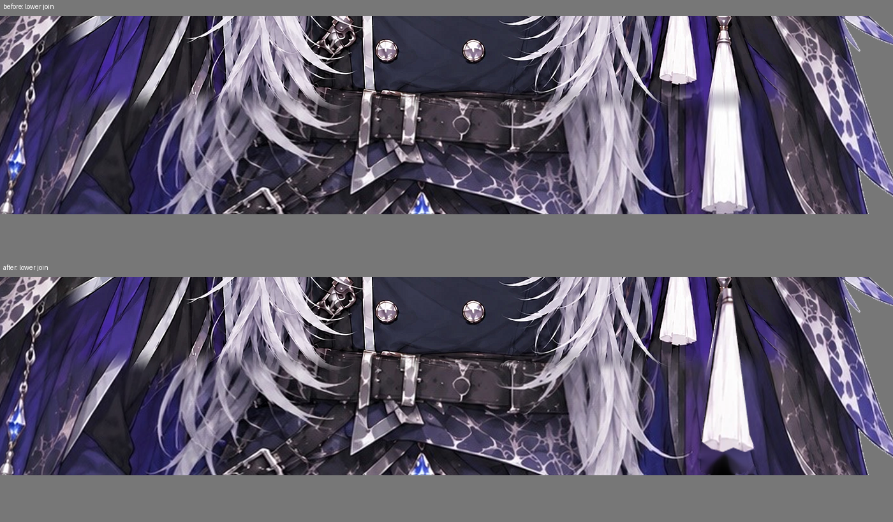
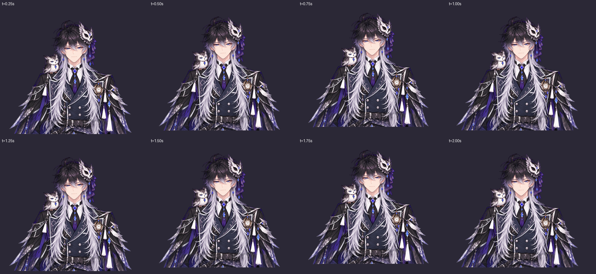
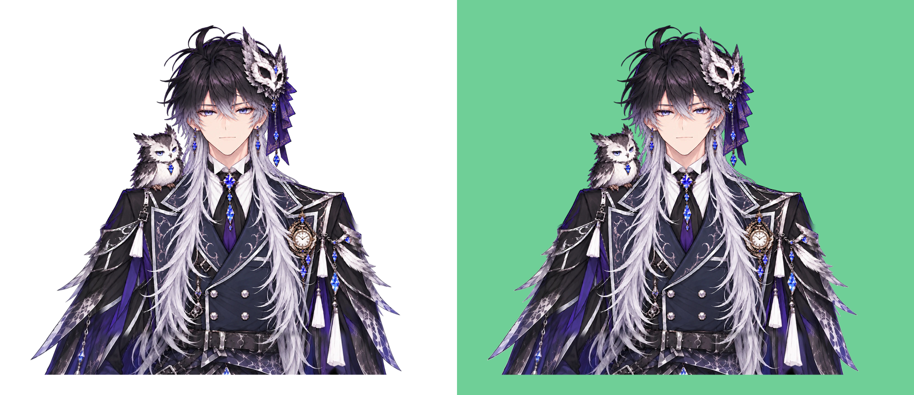

# アクセサリーの髪混入・胴の継ぎ目・長いタッセル・袖先の微調整

ユーザーの腕追加後の指摘に対応。基準はe43e15724691463c2d3269f978f2c74188ff417b。顔・口・表情のパラメータ、首の範囲、全身移動、髪の揺れを止める設定を保つ。

## 仮面側の飾りと髪を分ける

`ribbon`の古い多角形と`orn_chain`の下端に、耳横から肩へ伸びる銀髪が入っていた。拡大画像で前のリボン先端（約735,571）と後ろの紫の尾（約824,614）、鎖・宝石の輪郭を追い直した。三角形の銀髪を飾りから外し、元の髪側へ戻す。広い色条件だけで範囲を増やさない。

`costume_regions.json`から`ribbon_only_alpha.png`・`orn_chain_only_alpha.png`を生成し、bleedは1pxに抑える。仮面本体の形・回転を大きく作り替えず、従来のPhysRibbon/PhysChainを使う。

## 胴の接続とタッセル

外側の追加画像と元画像の色・模様の差を、単純な端の透過だけでつないでいた。追加層の接続部分は既存の衣装を境界条件にしてPoisson合成し、色の段差をなじませる。中央の顔や目は追加層のアルファが0のため、この合成で置き換えない。衣装の細部が元から完全一致する2画像ではないので、同一の線画を完全復元する処理ではない。

長い`hangR3`は旧画像の下端で切れ、下半分が固定された追加層に残っていた。元の鎖・宝石・取付金具を細く取り出し、既存の同じキャラの完全なタッセルの房を拡縮して先端を補う。新しい絵柄を生成せず、房全体を`[995,950]`を原点とするRGBAにまとめる。下端は約1498で、画像内に裾まで収まる。

ビルドの`frame_extension.attachments`で`hangR3`を置き換え、元の1374pxキャンバスに切り詰めない。旧パーツは元画素の取り分けに使い、体に元のタッセルを残さない。追加層の固定された房も局所的に消して背後の衣装で補う。揺れで補完範囲を広く露出しないよう、長い房の回転は最大約3.2度に抑える。

## 上下移動にだけ袖先が小さく反応する

PhysSleeveを新設し、BodyYの変化から小さなばねの応答を作る。横移動だけでは起動せず、停止後は収束する。「物理」OFFとリセットで解除する。既存の`rig_spec.physics`と`runtime._physics`は変更せず、専用の`_sleeveFlutter`を追加した。

追加した袖の外側だけに、画像端から外へ向かう重みで最大5pxの上下移動と1度の回転を適用する。旧画像との接続点では重み0。体・顔・長髪のメッシュへこの揺れを加えない。揺れ物の描画を先に行い、その後に体の呼吸と共通移動を適用する。

## 確認

上が変更前、下が修正後。リボン・鎖・タッセルを物理パラメータ±1で振り、髪の混入と房の切れ目を比較した。





BodyYを連続変化させて、実際の袖ドライバの反応も撮影。横のみ・上下・停止後・物理OFFをブラウザ試験で確認する。





Python29件、Node19件。元ビューアと配布HTMLの双方で袖の反応、顔・体・髪の非連動、長い房の表示下端、左右の余白、耳・眉・襟・口・表情・瞬きの既存検証を実行。顔の領域には切り抜きの取り分けが変わったことでメッシュ再計算に伴う微小な描画差があるが、口・目の画素や追跡設定は維持し、同じ姿勢で比較して確認した。実Webカメラ・OBSでの実機確認は利用者側で行う。

## 再生成と戻し方

`polish_costume.py`は追加画像を加工するので、毎回その前に`extend_frame.py`で元の追加画像を再作成する。加工済みPNGに繰り返し適用しない。

```sh
python tools/extend_frame.py
python tools/polish_costume.py
python -m live2d_ai build projects/owl_prince
python -m live2d_ai export projects/owl_prince -o dist/owl_prince.html
python -m unittest discover -s tests -v
node --test tests/tracking.test.cjs
```

今回の衣装の小修正を1コミットにまとめ、`git revert <今回のコミットSHA>`でソースと配布HTMLを戻せるようにする。

[変更前のHTML](https://github.com/98nryk89/V/blob/e43e15724691463c2d3269f978f2c74188ff417b/dist/owl_prince.html) を保存して開き直しても比較できる。元絵・提供した広い画像・元の髪マスクを上書きしない。
