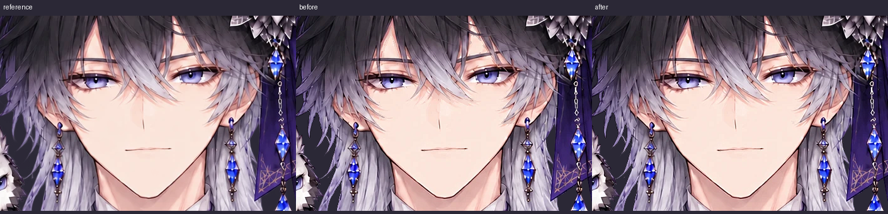
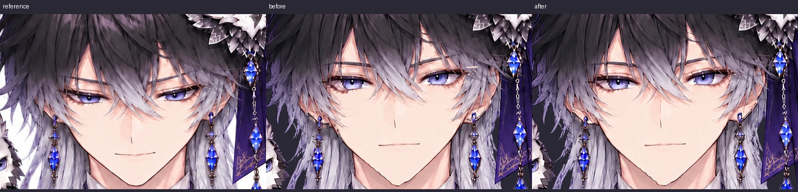
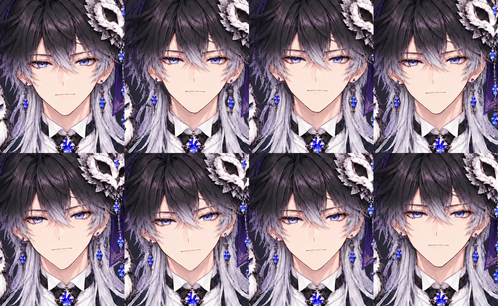

# 耳・眉・髪の切り取り修正

比較は左から提供参考絵、変更前、変更後。同じ元絵座標・同じ表示寸法で切り出した。うなずきの参考絵は別描画なので、形や表情の完全一致を示すものではない。




## 変更点

- 頭の髪は提供されたアルファに統一。旧4髪パーツを外し、長い銀髪は body に戻した。
- 眉と耳の肌を顔に統合。矩形の眉テクスチャや別々の肌の面を動かさない。
- 元絵に見えている耳の陰影・輪郭を残し、髪の下だけ提供済みの透明肌画像で補う。
- 半透明の毛先に肌色が二重に混ざらないよう、合成色から髪の色を分離する。
- 耳飾りの物理と WebGL ランタイムは変更していない。

## 再現・検証

リポジトリルートから実行する。このクラウド環境では Python を `/workspace/.venvs/live2d/bin/python` に置き換え、`CHROME_PATH=/usr/bin/chromium` を指定する。

```sh
python -m live2d_ai build projects/owl_prince
python -m unittest discover -s tests -v
python tools/fidelity.py projects/owl_prince/out samples/ref12.png /tmp/fidelity-error.png
python tools/physics_test.py projects/owl_prince/out
python -m live2d_ai preview projects/owl_prince --poses 'down:AngleY=-10;up:AngleY=5;left:AngleX=-5;right:AngleX=5;blink:EyeLOpen=0,EyeROpen=0' --out /tmp/review
python -m live2d_ai export projects/owl_prince -o dist/owl_prince.html
```

回帰テスト4件: 可視の元絵を維持、提供画像で隠れた肌だけ補完、アルファ合成、無効な参照画像の拒否。静止 PSNR は full 34.39→34.42 / face 33.55→34.39 / eyes 32.52→32.68 dB。上下左右・まばたきと、頭を動かして物理を駆動したフレームも画像で確認する。

GitHub の `dist/owl_prince.html` で「Download raw file」を押し、保存したファイルを Chrome で開く。マウス追従を切った状態で上下スライダーを -10〜+5 に動かす。次にマウス追従と物理をオンにし、耳の輪と肌が独立して揺れないか、眉付近に四角い切れ目が出ないか確認する。

## 残っている確認事項

髪は毛束ごとの詳細なリギングではない。長髪とのつなぎ目、リボン右下の灰色片、実機カメラは追加確認が必要。参考のうなずき画像との形の完全一致や、すべての違和感の解消を保証する変更ではない。



現在のビルドで WebGL 描画、21スライダー、リセット、マウス追従を確認し、JavaScript 例外は0件。物理パラメータを最大値にした検査でも、顔・body・左フープ・右フープ上端の独立変位は0、右の鎖・宝石側は変位あり。頭の上下では顔も移動する。頭の連続運動を121ステップ進め、8フレームを上に掲載した。
