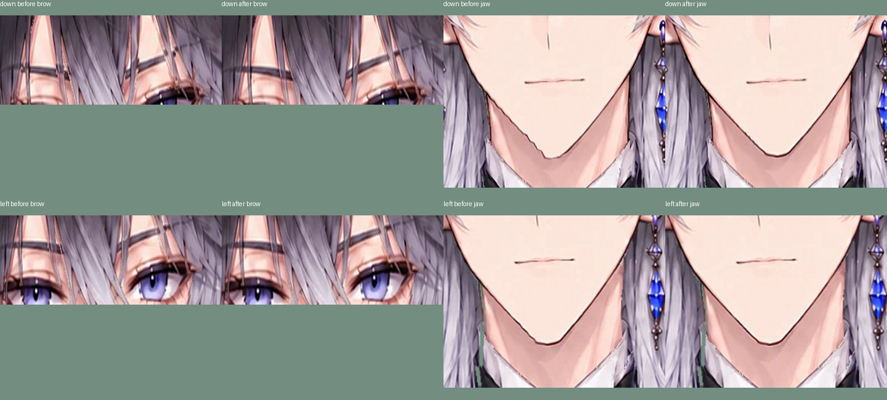
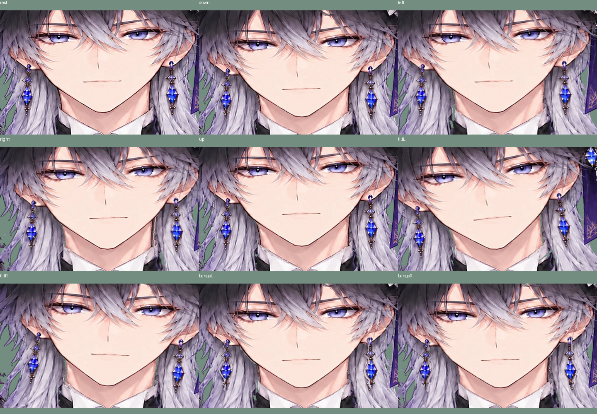
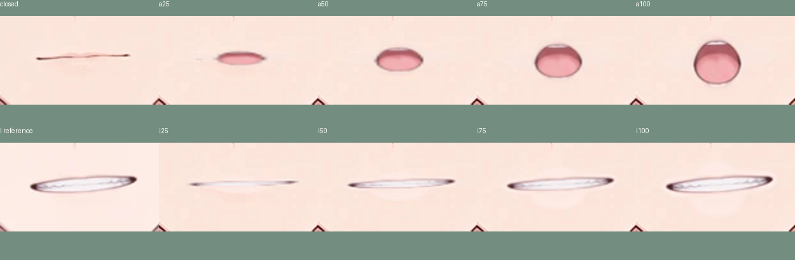

# 眉を肌に固定・輪郭の調整・A/Iの排他的な自動開閉

## 眉と輪郭

露出した眉はfaceのまま。眉の上を横切る前髪に含まれていた眉の画素は、切り抜きを増やさず肌と同じ深度・変形にそろえる。その小さい範囲では前髪の回転を除外し、周囲へ滑らかにつなぐ。眉を別の表情パラメータで動かさない。笑顔と驚きも目の範囲だけを差し替える。

顔の測定幅の端で深度が急に変化し、左/下向きで片側の顎の線が圧縮されていた。下顎の縁を同じ平面へ滑らかにつなぎ、faceのメッシュを8pxから4pxにした。首に残っていた元の顎の線は、元絵の顎直下の肌から隠れた部分だけを補完する。生成スクリプトは `python tools/refine_face.py`、補完画像は `projects/owl_prince/neck_underjaw.png`。

## 口

今回の指定でE単独を廃止。提供済みの `samples/vowel_a.png` と `samples/vowel_i.png` から口だけを使い、閉じ口/A/Iに限定する。驚き専用の口も外した。笑顔・驚きの手動操作はそのまま。

カメラの顎の開き、口の横への広がり、唇の縦横比からA/Iを自動選択する。境界にはヒステリシスと3フレームの保持を設け、形の選択は離散的に、開き具合は連続的に変える。音声の母音認識ではなく、カメラの見た目からの推定。

- ChromeでHTMLを開き、カメラの「開始」を押す。
- 正面で口を閉じ、「正面を較正」を押す。口幅と唇の隙間も基準になる。
- 縦に開いて「あ」、横に広げて「い」を試す。
- カメラ停止中は「口の形 0=あ / 1=い」と「口の開き」のスライダーで確認できる。

`MouthOpen`は0〜1、`MouthForm`は0=A/1=I。等値によるopacityゲートで両方を混ぜない。旧VowelEは出力しない。

## 確認と戻し方

Python22件（リポジトリと単一HTMLのブラウザ2件を含む）、Node12件、すべて通過・スキップなし。眉の肌との一致は、上下左右・呼吸・前髪物理ありの実頂点で検査。表情で眉や中央の前髪を差し替えないこと、A/Iの排他、閉じ口、カメラを模した入力からI/Aの実表示まで確認した。既存の耳の取付点、髪の面積比、襟の6か所の透明度などの閾値は変更していない。

休止PSNRはfull34.28/face33.36/eyes32.88dB（直前34.28/33.39/32.89）。変化の大きさを見る数値で、すべての角度の品質保証ではない。実機カメラは未確認で、自動口判定はユーザー環境で感度の微調整が必要になる場合がある。

ソースは目的別に、53de1ba（眉の肌への固定と顎）、de21776（驚き目が眉にかからない切り取り）、aac6186（自動A/I口）に分けた。対象を `git revert` した後は `python -m live2d_ai build projects/owl_prince` と `python -m live2d_ai export projects/owl_prince -o dist/owl_prince.html` を実行する。out/は生成物で、未使用の古いPNGが残る場合もactiveなパーツはrig.jsonを確認する。物理ドライバ本体には変更していない。
