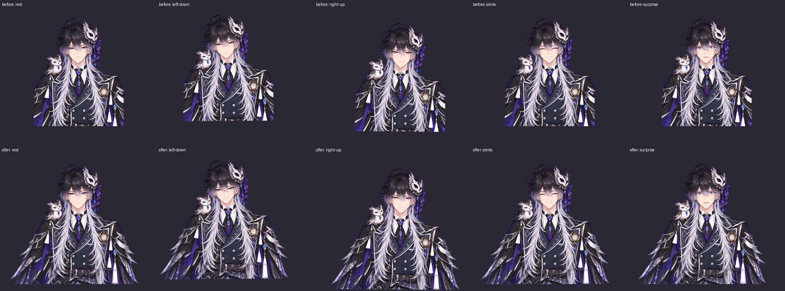
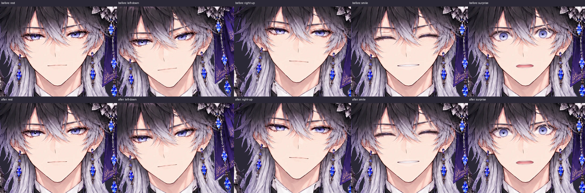
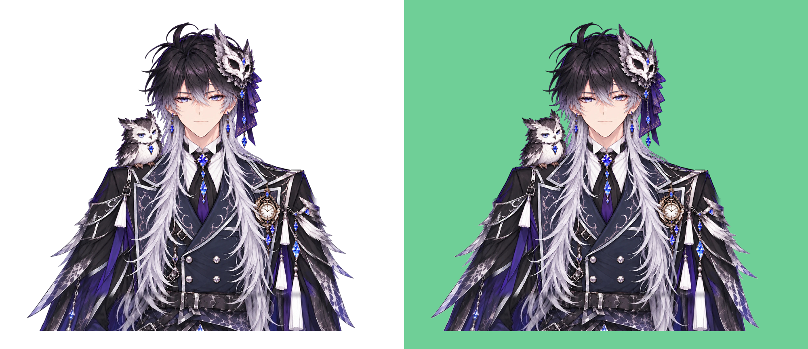

# 腕・衣装を追加して左右を見切れなくする

2026-10-19。ユーザー提供ZIP内の1123×1032の画像を、そのまま `samples/wide_frame_ref.png` に保存。既存の顔・髪・耳・表情は作り直さず、左右の腕と腰まわりを補う。

## 追加方法

既存の元絵は1145×1374で、腕自体が左右の画像端で切れていた。表示範囲だけを広げても元画像に存在しない部分は出ないため、外側を追加するレイヤーを使う。

追加画像と元絵では、衣装の縮尺や細部が完全には一致しない。左右の袖と下部衣装に分けて特徴点から位置合わせを測り、その変換を滑らかにつなぐ。測定した変換は `frame_extension_regions.json` に固定している。画像の白背景のうち外につながる部分を除き、衣装内の白い装飾は残す。原画像の再生成はしていない。

`tools/extend_frame.py` が既存の座標系の外へ広がる `frame_extension.png` を作る。中央は透明にして頭・目・顔の二重表示を防ぎ、旧画像の左右・下端から70px以内にだけ潜り込ませる。写真自体の下端は水平な切れ方になるよう合わせる。写真より下の見えていない腕・手・衣装を新しく描き足してはいない。

`parts_spec.json.frame_extension` を指定したプロジェクトだけ、ビルド末尾に次を行う。

- 既存パーツの左右・下端45pxだけを滑らかに透過させ、新しいレイヤーへつなぐ。中央の画素・既存のメッシュ・座標・動きは維持する。
- 追加画像を元画像の外へ配置し、`frame_extension`（z=-1）として最背面に足す。
- 追加レイヤーはbodyと全く同じ呼吸・共通移動を使う。顔の回転や独立した髪の物理は加えない。

52パーツ。元の51パーツのbbox・メッシュ・effectsをビルド前と比較して一致を確認。旧パーツの画像は端のアルファのみを変更し、顔・髪のマスク原本は変更しない。髪を揺らさない仕様、眉の肌への固定、口の排他と自動表情判定は維持する。

表示範囲は `[-430,-110,2000,1730]` に広げ、腕と腰まで収める。全身移動・回転・呼吸・ゆらぎを組み合わせた端の検査では、全可視パーツのメッシュが左右の枠内にあり、最小余白は左約34px・右約143px。これは画像座標の値で、画面では表示倍率に応じて縮小される。

## 確認画像

上段が変更前、下段が追加後。同じ表示範囲で、静止・左下への最大移動・右上への最大移動・笑顔・驚きを比較する。





比較した5姿勢で顔周辺の切り出し画像が画素単位で一致。白背景・緑背景でも追加袖と毛先の縁を目視確認した。



元ビューアと配布HTMLの両方で、追加レイヤーと体の全頂点が呼吸・移動に一致すること、左右の端が枠内であることを検証する。耳の取付点・眉・襟・口・表情・瞬きの既存検証も維持する。今回の確認はChromiumと模擬追跡入力で、実WebカメラとOBSは利用者PCでの確認が必要。

## 再生成

リポジトリ直下で実行する。PNGの再生成はバイト一致を確認している。

```sh
python tools/extend_frame.py
python -m live2d_ai build projects/owl_prince
python -m live2d_ai export projects/owl_prince -o dist/owl_prince.html
```

埋め込み用HTMLも必要な場合は、既存どおり `live2d_ai.export_html.export_html('projects/owl_prince/out','dist/owl_prince_artifact.html',fragment=True)` を使う。PNGを再生成する場合に、過去の髪マスクを無条件で作り直す必要はない。

検証:

```sh
python -m unittest discover -s tests -v
node --test tests/tracking.test.cjs
```

Python27件（元ビューア・配布HTMLを含む）、Node19件。画像端のアルファ・元の中央の画素・外側の座標を保つビルド処理の検証を追加している。

## 戻す

変更前は **ecf98c9f5e9d2ac2f238426d400fa8ed4a2dab11**。

[変更前のHTML](https://github.com/98nryk89/V/blob/ecf98c9f5e9d2ac2f238426d400fa8ed4a2dab11/dist/owl_prince.html) を保存して開けば、すぐ比較できる。

今回のコミット `Extend sleeves and costume while preserving the existing face rig` を `git revert <コミットSHA>` すれば、追加画像・ビルド処理・仕様・配布HTMLをまとめて戻せる。元画像と既存の髪マスクは変更していない。
