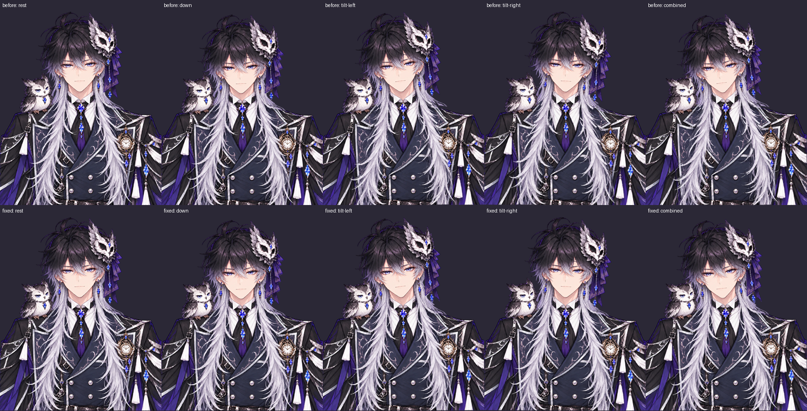
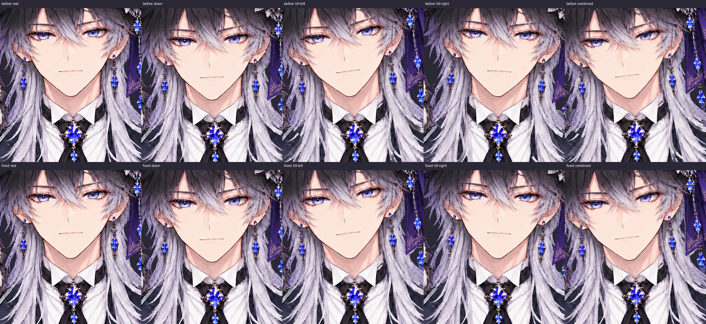

# 髪を揺らさない試験版

2026-10-17 の追加指示による一時的な比較版。従来の長髪追従版を削除せず、髪の動きだけを1コミットで変更する。

- 前髪のPhysBangsと、分割した毛先2か所のPhysHairL/Rを髪の変換から外す。物理ドライバ・耳飾りは変更しない。
- 頭の髪は顔と離れないよう頭の回転と呼吸へ追従する。元絵のy=520までは従来どおり、520〜760では追従率を二乗で減衰、760以降は0。顔裏の銀髪も同じ変換にする。
- 胸元から下の髪・毛先は体と同じ呼吸・移動だけ。服との呼吸のずれを避けるため、y520→760で体の呼吸への追従を増やす。全身のBodyX/Y移動は残す。顔の回転範囲（左右/かしげ±5度、上5度/下10度）、口・自動表情・黒目追従は変更しない。
- 切り抜きマスク・画像・メッシュ・深度は変更せず、既存ビルドの4髪パーツのeffectsだけをソースのテンプレートから再展開してHTMLを再出力した。通常のbuildでも同じ設定になる。

## 確認

実Chromiumで静止・下向き・左右かしげ・複合角度の5ポーズを変更前後で比較。静止描画は画素単位で一致。毛束の境界を新しく分割せず、首から胸の追従を滑らかに減らしている。

Python 25件、Nodeカメラ変換19件が成功（スキップなし）。ブラウザ試験はリポジトリ側ビューアと配布HTMLの両方を検査。y>=760の髪メッシュ全頂点が複合角度と呼吸中も体に一致し、顔は独立して動くこと、髪の物理入力で髪・毛先が動かないことを検証。眉の肌への固定、耳の取付点、襟の不透明性、まばたきの検証も維持する。実機カメラでの見え方は利用者の確認が必要。

## 直前の版へ戻す

直前の版は **af92aabfd565876cb2afecfeb6b74cf128469d33**。

[従来の長髪追従版HTML](https://github.com/98nryk89/V/blob/af92aabfd565876cb2afecfeb6b74cf128469d33/dist/owl_prince.html) の Download raw file（↓）で取得しChromeで開けば、いつでも比較できる。

この試験のコミットは `Try fixed long hair while preserving face movement`。Git履歴からそのコミットを `git revert <試験コミットSHA>` するだけで、ソース・配布HTML・テストをまとめて直前の版へ戻せる。切り抜きの再生成は不要。以後別の修正が入っている場合は、その修正を消すresetではなく、この試験コミットだけをrevertする。
