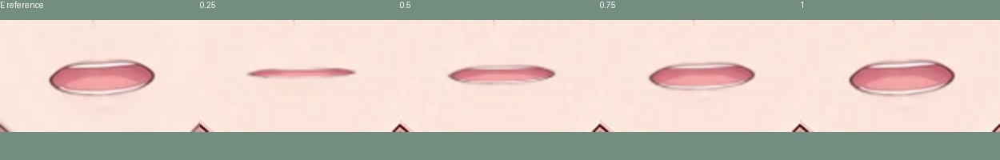
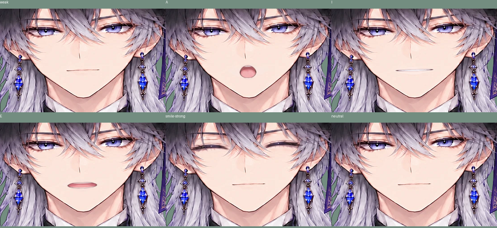

# Eの再追加・低感度の口と笑顔

口は提供済み `samples/vowel_e.png` を再追加し、閉じ口・A・I・Eから一つだけ表示する。MouthFormは0=A/1=I/2=E、MouthOpenは共通の連続値。等値ゲートのためA/I/Eは重ならない。

小さな動きでは口を開かない。顎の開きが.18を超えるか、較正した唇の縦横比との差が.09を超えるまで閉じる。開いた後は顎.13〜.55を0〜1へ変換し、従来の滑らかな追従を使う。顎.12未満かつ唇差.055未満になってから閉じるので境界でちらつきにくい。Aは縦開き、Iは横に広げた薄い開口、Eは横に広げてIより縦にも開いた形。音声認識ではなくカメラの見た目からの推定。

自動笑顔は初期ONの「笑顔を自動判定（低感度）」で試せる。左右の笑顔スコアがともに.80超の状態が約.45秒続いたときだけ笑顔にする。.55未満が約.35秒続くと真顔へ戻す。弱い笑顔、片側だけ、短い動きには反応しない。顔を検出できなくなった場合も保持をリセットする。

- カメラを開始し、口を閉じた正面で「正面を較正」。
- 小さく口を動かした状態と、大きく「あ／い／え」を作った状態を比べる。
- 強めに笑って少し保持し、自動笑顔を試す。
- 自動笑顔を止めるにはチェックを外す。数字1/0/2や表情ボタンでも自動判定を止めて手動へ戻る。
- リセットは初期状態（真顔・自動笑顔ON）に戻る。驚きは自動判定しない。

Python22件（配布HTMLと元ビューアのブラウザ2件を含む）＋Node16件、すべて通過・スキップなし。弱い口の動きの拒否、A/I/Eの排他、強い両側笑顔の保持と解除、顔検出を失ったときの解除、手動優先を検査した。実際のWebカメラは未確認で、感度は使用環境で再調整が必要になる場合がある。

休止PSNRは前版と同じfull34.28/face33.36/eyes32.88dB。45パーツ。眉・顔/輪郭・髪・耳・フクロウ・体のリグと物理ドライバは維持している。元の描画を新しく生成していない。

694cf08はEと低感度の口、自動笑顔は次のソースコミットに分けている。戻す場合は対象ソースをrevert後、build/exportする。詳しい既存の眉/輪郭の変更はface-mouth.mdを参照。

感度を少し上げる追加指示で、上記を口の開始jaw .22→.18 / 唇差 .11→.09、最大開きjaw .60→.55、笑顔スコア .86→.80 / 保持 .6秒→.45秒へ調整した。微小な動きの除外、口の排他、手動優先、笑顔解除のヒステリシスは維持。今回の検証はNode17件と配布HTML/元ビューアの2件、計19件を通過。
