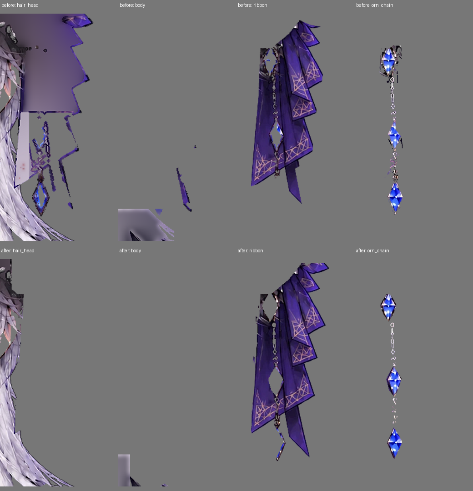
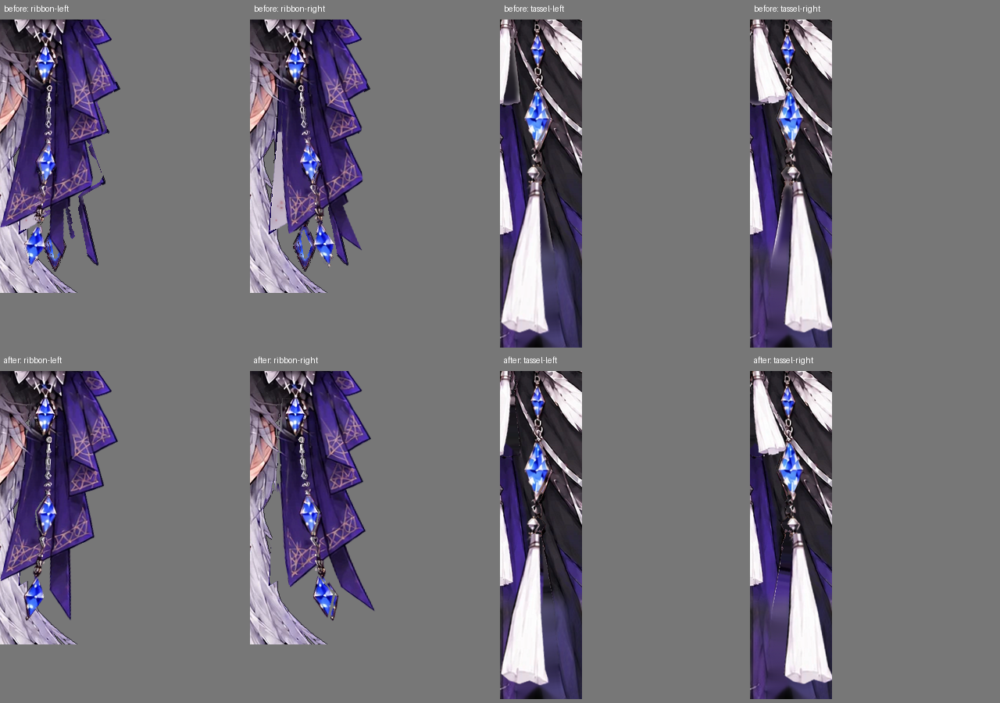
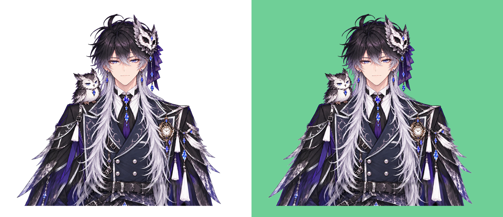

# 蛇腹リボンの裏側補完と背景片・タッセルのにじみ

基準版: `15526746be45360a16b3c1c5fd98de30e30a7926`。蛇腹リボンの裏は銀髪で埋めず、飾りが移動した場所を透過させる。元から見える隣の髪は残す。既存の顔・表情・口・袖の動きと物理設定は変更しない。

## 原因と変更

- `hair_head`の再構成範囲がリボンの形を含み、飾りを振ると髪色の平らな面が露出していた。`ornament_no_backfill.png`と`fade_exposed`で、この領域の**隠れた部分の補完だけ**を止める。bodyにも同じ制約を加え、既存の他の補完禁止範囲を維持する。
- 元の髪マスクには飾りも含まれているため、飾りの輪郭から漏れた布・金具が髪や体に残っていた。肌・耳を保護しつつ、紫や金色の元画素をリボンに割り当て直す。低い透明度の縁も取りこぼさない。
- 鎖の広い色条件は布の模様まで拾っていた。3つの宝石の輪郭と金属リンクの細い領域を別々に指定し、布の模様を鎖へ混ぜない。リボンと鎖のbleedは0にする。
- それでも独立して残る小さな輪郭片は、リボン周辺の指定領域内に全体が収まる小成分だけを除く。髪/体は256px以下、リボンは128px以下。領域を横切る本物の毛束や、大きい布の部分は残す。鎖の細かいリンクにはこの除去を適用しない。
- 小タッセルの4pxの下側潜り込みを止め、背後の白いぼやけを除く。房のピンホールまで透過させると粒状になったため、元の`close=2`は維持する。
- タッセルが動いた後に白い残像が出ないよう、隠れる衣装だけを近隣の暗い布色で補う。`costume_body_backing.png`は既存の襟の補完PNGを保ち、タッセル周辺だけを加えたもの。襟の白さを暗い布色に置き換えない。
- 大きい房の拡大補間をLanczosにし、輪郭の透明度と弱い局所シャープを調整する。既存の房の画素を使い、絵柄を再生成しない。

この変更は追加PNG・パーツ設定とビルド時の局所的なアルファ整理で行う。`rig_spec.json`、`viewer/runtime.js`、`viewer/tracking.js`は変更していない。

## 比較・検証

上が変更前、下が修正後。パーツを分けて、髪色の面と背景片を確認する。



リボン・鎖・タッセルを±方向へ動かして比較。灰色は確認用の背景で、モデルには入らない。



白背景・緑背景でも縁を確認する。



Python32件（元ビューアと配布HTMLを含む）、Node19件。次を確認している。

- リボンと鎖を隠した実WebGL描画で、問題領域2点のアルファがほぼ0になる。
- ビルド済みの髪画像でも補完面のアルファが0、隣の本物の髪は残る。
- 衣装の補完画像の上部800行は、元の襟補完と画素単位で一致する。
- 小成分の除去は指定領域内に完全に収まる小片だけで、毛束・大きな飾り・領域外は維持する。
- 耳・眉・襟・口・表情・袖・最大移動の既存検証も維持する。

カメラ入力は模擬入力での検証。実WebカメラとOBSは利用者のPCで確認する。

## 再生成・戻し方

```sh
python tools/extend_frame.py
python tools/polish_costume.py
python -m live2d_ai build projects/owl_prince
python -m live2d_ai export projects/owl_prince -o dist/owl_prince.html
python -m unittest discover -s tests -v
node --test tests/tracking.test.cjs
```

`polish_costume.py`で生成する8つのPNGは再生成のバイト一致を確認している。加工済みの追加画像にpolishだけを繰り返さず、必ずextend_frameから実行する。

今回のコミットだけを `git revert <今回のコミットSHA>` すれば、ソース・PNG・配布HTMLを変更前へ戻せる。

[変更前のHTML](https://github.com/98nryk89/V/blob/15526746be45360a16b3c1c5fd98de30e30a7926/dist/owl_prince.html)
