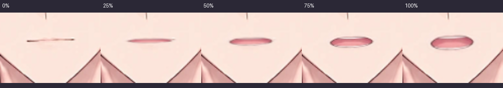
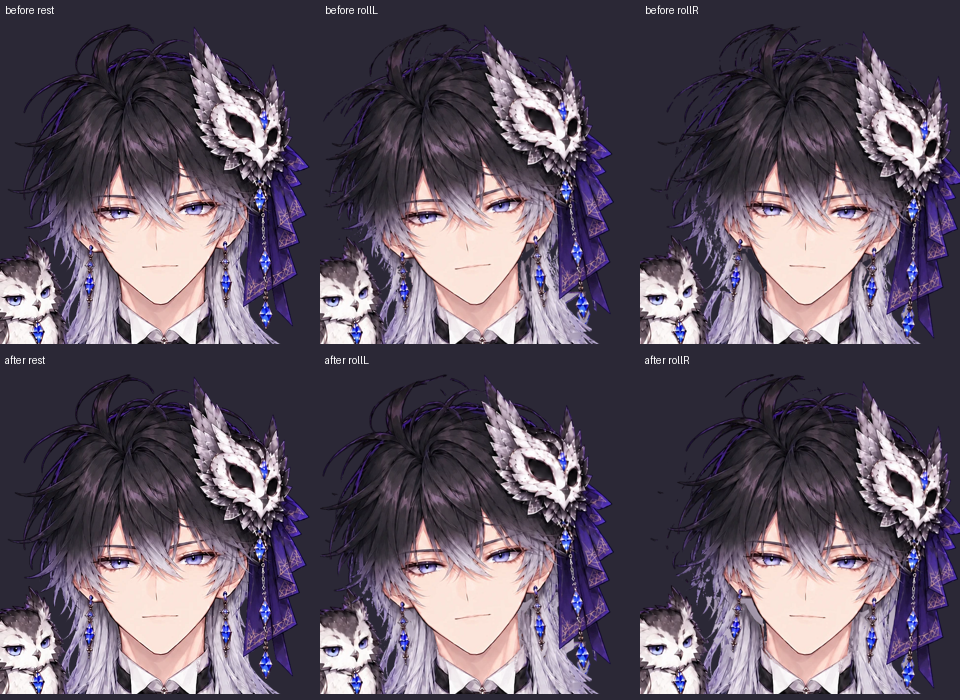
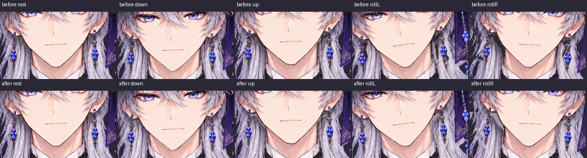

# 毛先・耳飾りの裏・右耳・Eの口

## 変更

- 頭の髪マスクと元絵のアルファの差が静止した body に残る問題を修正。元の細い房を残し、斜め1画素の毛束も連結とみなす。ごく小さい孤立点を除去する。
- 左耳飾りに混入した隣の銀髪を、元絵を拡大して追った輪郭マスクで外す。裏側には近隣の銀髪色を補う。新たに埋める透明な隙間は耳飾り付近の限定範囲だけ。
- 右耳の肌を、提供済み耳注釈から切り出した剛体パーツへ変更。顔の曲面による局所的な圧縮を外し、金具と取付点の奥行きをそろえる。肌とフープ上端に揺れは付けず、輪より下だけ物理で揺れる。
- 参考の E の口を縦に連続変形して開閉。Aの二値切替を廃止し、0〜1の開きと時間方向の平滑化を使う。

元絵と元の提供マスクは保存している。添付画像を参照し、既存の元絵・提供髪レイヤー・耳注釈の画素から修正した。頭の回転範囲、BodyX/Yの移動量、1/0キーによる手動笑顔は維持する。

## 比較

口は左から0/25/50/75/100%。複数母音の混合ではなく、Eの開きが増える。



髪は上段が変更前、下段が変更後。静止・左右の首かしげを同じ元絵座標で比較している。



耳は上段が変更前、下段が変更後。左から静止・下向き・上向き・左右の首かしげ。



## 検証

Node 7件、Python 13件、合計20件成功。Pythonのうち2件はビューア本体と出力HTMLを実Chromiumで操作する試験。回転と平行移動の分離、Eの中間形状と時間的な収束、手動笑顔の保持、右耳の面積比と金具取付点の一致、下地補完の範囲、細い毛束の保持を確認する。

耳より上の指定確認領域（提供髪マスク内・肌を除く・y<440）で body に残る5%以上のアルファは10521画素から0になった。銀髪の補完を広く不透明化した試作は塊に見えたため採用していない。

静止PSNRは full 34.25 / face 33.12 / eyes 32.79 dB。前版の full 34.42 / face 34.39 / eyes 32.68 dBから、耳の分割・銀髪の補完を含む元絵との差分は増えている。静止・上下・首かしげの比較画像と、連続運動のフレームを目視した。

```sh
python tools/refine_cutouts.py
python -m live2d_ai build projects/owl_prince
python -m live2d_ai export projects/owl_prince -o dist/owl_prince.html
node --test tests/tracking.test.cjs
CHROME_PATH=/usr/bin/chromium python -m unittest discover -s tests -v
```

このクラウドではPythonは `/workspace/.venvs/live2d/bin/python`。`refine_cutouts.py` は6つのマスク・補完画像を再生成する。元の提供画像を上書きしない。

補完は隠れていた部分の色の近似で、元絵に無かった銀髪の線画を別角度まで復元する処理ではない。実機カメラの追従感と背景を替えた見え方は手元で確認する。
