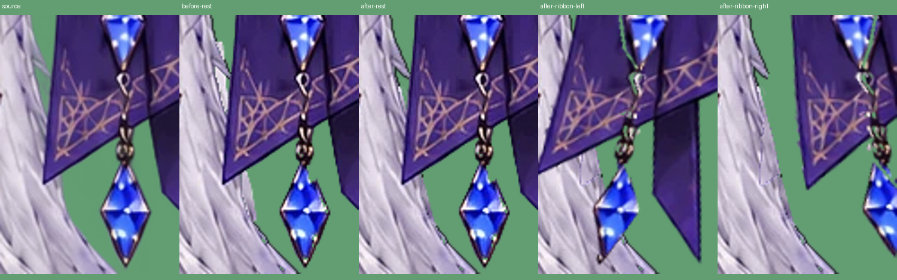

# 補完した銀髪の毛流れと輪郭を合わせる

変更前: `9986fae4834c435f903f21bb7e376742b781a631`。

前版は元絵の20px隣をそのまま移したため、明暗と毛筋のつながりが変わり、折れ線の輪郭と合わせて貼り付けた部分が見えた。また、元のリボン領域より実際の布の暗い縁が数px左にあり、髪の上に紫の線として残っていた。

先端の補完輪郭を、元の銀髪の輪郭に続く滑らかな曲線へ変更する。元絵の隣の毛筋を使いつつ、元の髪を境界条件にした小範囲のPoisson補間で明暗を合わせる。透明な外側を黒い境界として扱わない。見えている元の毛束をぼかしたり、髪全体を再生成したりしない。

布の暗い縁だけを局所の色と範囲でリボンへ戻す。上段リボン裏の古い平らな補完も参照画像から除外し、耳裏は保持。顔・耳・口・表情・体・衣装・動きの設定は変更しない。

左から元絵、修正前、修正後、修正後のリボン左右揺れ。緑は確認用背景。髪単体とうなずきも目視確認する。

再生成は `tools/extend_frame.py` → `tools/polish_costume.py` → build → 両HTMLのexport。今回も1コミットで戻せる。実Webカメラ・OBSはこの環境では未検証。

検証: Python32件（配布HTML・元ビューアを含む）とNode19件が成功。布の縁を髪へ残さず、その裏の髪は銀色で不透明、上段リボン裏は透明のまま。9枚の生成画像は再生成でバイト一致。

生成された52パーツのうち、画素が変わるのはhair_headとribbonだけ。顔・目の休止描画は前版と画素一致。元絵を含めた先端の拡大比較と、リボン左右揺れ・うなずきを目視確認済み。
