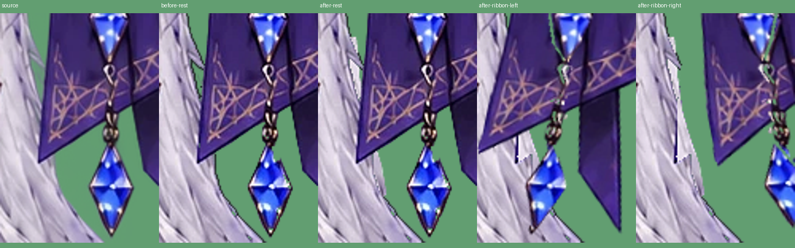

# リボン先端に接する髪だけを戻す

変更前は `68f033927cddd4b9e3098dffef6f75dca3e429f6`。

リボン裏の補完を一括で止めた範囲に、最下段の折り目へ潜る銀髪も含まれていた。`tools/polish_costume.py` の `tip_hair` で、その毛束に沿う狭い範囲だけを髪の補完禁止マスクから外す。体の補完禁止、上段のリボン裏の透過、飾りの切り抜きは維持する。

髪の見えている画素は元絵のまま。隠れていた下端だけを同じ高さの20px隣にある銀髪の元画素から補完し、リボンに毛束を持たせない。動き・表情・口・衣装は変更しない。

左から元絵、変更前、変更後、左右にリボンを振った変更後。緑は透過の確認用背景。髪単体でも先端のつながりを確認する。

再生成順は `tools/extend_frame.py` → `tools/polish_costume.py` → build → export。今回の変更は1コミットで、`git revert <今回のSHA>` により配布HTMLと生成マスクまで戻せる。

検証: Python32件（配布HTMLと元ビューアを含む）とNode19件。先端の髪が不透明かつ銀髪色で残り、上段2点は透過のままになることを確認。実Webカメラ・OBSはこの環境では未検証。

生成された52パーツのうち、画素が変わるのはhair_headだけ。顔と目の休止描画は変更前と画素一致。元絵との休止描画PSNRは顔30.22dB・目32.04dB（今回の髪修正前後で顔・目は同一）。
