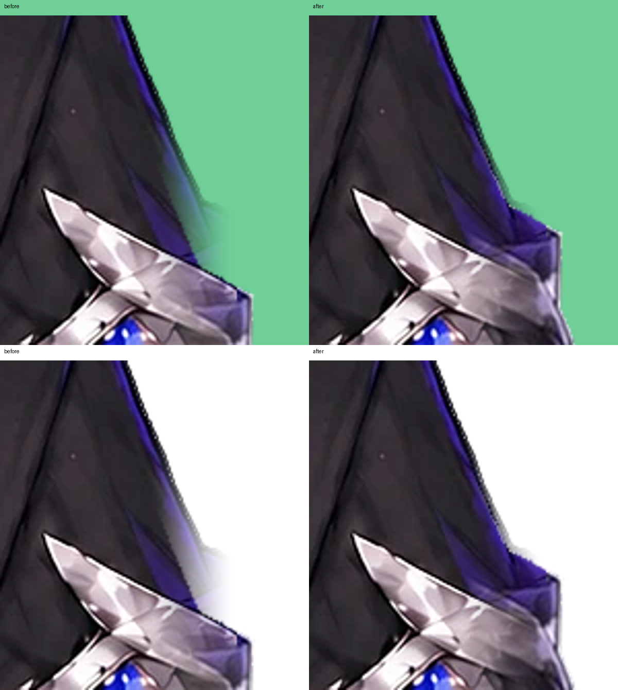

# 左腕の衣装の透けを止める

変更前: `ba98ebc1f6f19e341c08d6e5307efdf3fce0168e`。

対象はキャラ本人の左腕（画面右側）。元の袖と追加画像の上腕の輪郭が少し違い、追加画像がない部分にも旧画像端の45pxフェードがかかっていた。元は不透明な布が、元絵座標(1115,850)でアルファ181まで薄くなっていた。

tools/extend_frame.pyで追加層の左上腕だけを最大30px上へ位置合わせし、薄くなった布の下に不透明な衣装が入るようにする。左右・上下に滑らかに減衰させて、他の領域へ接続する。旧パーツのアルファや輪郭をそのままにし、元画像端で切れた布を露出させない。模様は提供された腕画像の画素を使用する。

顔・髪・リボン・表情・衣装の動きは変更しない。OBSのクロマキー設定とは独立した、モデル自体の透過の修正。

再生成はtools/extend_frame.py → tools/polish_costume.py → build → 両HTMLのexport。今回の1コミットをrevertすると、ソースと配布HTMLを一緒に戻せる。

検証: Python32件（元ビューア・配布HTMLの実WebGL描画を含む）とNode19件が成功。透けていた描画上の確認点はアルファ181/217/243から255へ改善。左上腕の確認領域で、輪郭から6px内側に残る半透明画素は222から0へ。白・緑背景、うなずき、袖の上下揺れ、全身の左右上下移動を確認した。

生成画像の変更はframe_extensionだけで、元からある全パーツの画像はバイト一致。顔と目の休止描画も前版と画素一致。実Webカメラ・OBSでの録画確認は利用者PCで行う。
