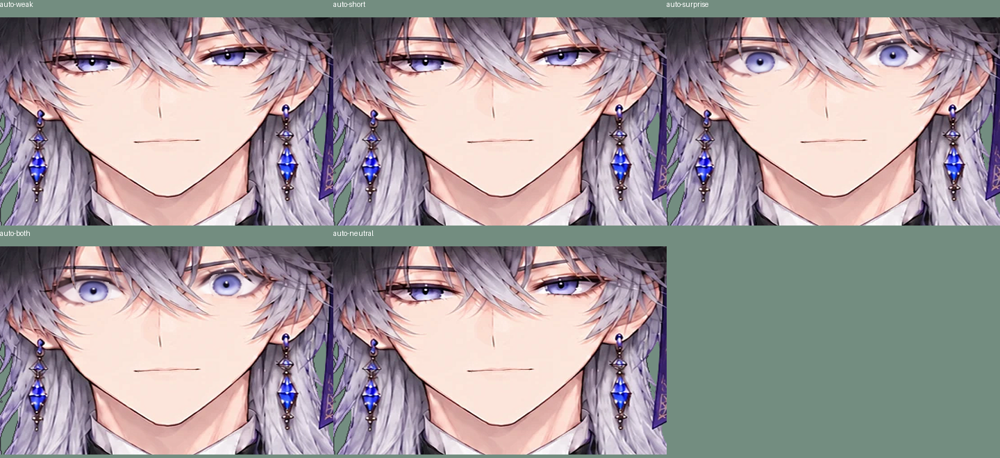
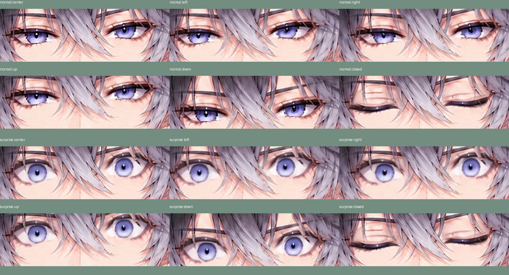
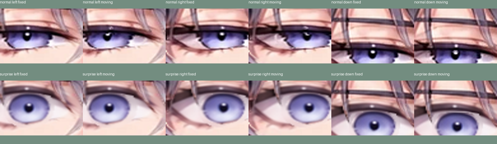

# 見開きの自動驚きと、黒目の小さな追従

## 驚き顔の自動判定

笑顔と同じ感度で、左右の `eyeWide` がともに.80を超える状態が約.45秒続くと驚き顔にする。.55未満が約.35秒続くと解除する。片側だけ・弱い見開き・短い動き・瞬き中では起動させない。笑顔と同時に検出した場合は驚きを優先し、両方を重ねない。

「驚きを自動判定（低感度）」は初期ONで、笑顔のチェックとは独立に停止できる。数字1/0/2や表情ボタンを使うと、自動判定を両方停止して手動操作を優先する。リセットは両方ONへ戻す。顔検出を失ったときや正面較正では保持をリセットする。

## 黒目の追従

通常顔と驚き顔の虹彩・瞳孔を、提供済みの元絵と驚き参考PNGから切り出して一緒に動かす。眉・まつ毛・肌・まぶたはその追加追従に含めない。目線を別に認識する変更ではなく、顔の回転と体の位置に応じた小さな連動。

| 入力 | 黒目の追加移動（元絵の座標） |
|---|---|
| AngleX ±5度 | 左右±2px |
| AngleY 上+5 / 下-10度 | 上-1px / 下+1px |
| BodyX ±1 | 左右±1px |
| BodyY ±1 | 上下±.5px |

合計は最大およそ左右3px・上下1.5px。全身共通のBody移動に、黒目だけがこの小さい追加移動を持つ。固定した開口マスクでクリップし、瞬きパッチはその上に表示する。笑顔の閉じた目では黒目は見せない。

元の通常iris領域は特に左の虹彩右縁まで届いていなかったので、実際の色の範囲まで切り直した。元の黒目が隠していた白目は、同じ目の隣の白目色から局所的に補完する。見えているキャラをAIで再生成していない。隠れた虹彩を大きく描き足す変更でもないため、移動幅を小さく制限している。

## 試し方と検証

カメラを開始し、口を閉じた正面で較正してから、目を見開いて少し保持する。顔を上下左右へ動かし、黒目の小さな追従を見る。カメラを使わず確認する場合は、マウス追従かAngleX/Y・BodyX/Yのスライダー、数字2の手動驚きでも試せる。手動操作で自動判定を止めた後はチェックをONに戻す。

Python25件（元ビューアと配布HTMLのブラウザ2件を含む）＋Node19件、すべて通過・スキップなし。自動見開きの閾値/保持/解除/瞬き抑制/同時検出の優先、通常/驚きの黒目の追加移動量とクリップ、開口と下まぶたの分離、白目の補完範囲を確認。既存の耳の取付点、髪の面積比、眉の肌への固定、襟の透明度などの閾値は変更していない。実機カメラでの感度は未確認。

休止PSNRはfull34.27/face33.22/eyes31.96dB（前版34.28/33.36/32.88）。黒目を分離したため目の境界には画素の差があり、元絵と完全一致したという意味ではない。静止だけでなく、上下左右・通常/驚き・閉眼の描画を目視した。51パーツ（6枚の追加には表示しないクリップ用マスク4枚を含む）。

再生成は従来のマスク生成の後に `python tools/refine_gaze.py`、build、export。5つの生成ファイル（gaze_regions、両irisアルファ、通常/驚きの白目補完）がバイト一致で再生成できることを確認した。通常irisは元色を保つためpreserve_sourceを使い、驚きのref_patchではRGBAのfill_layerで隠れた黒目位置だけを白目に置換する。

ソースは92dd457（自動驚き）、9aae083（黒目の切り出しと追従）に分けた。戻す場合は目的のソースコミットをrevertし、build/exportをやり直す。物理ドライバ本体と、頭・体の移動/回転範囲は維持している。
