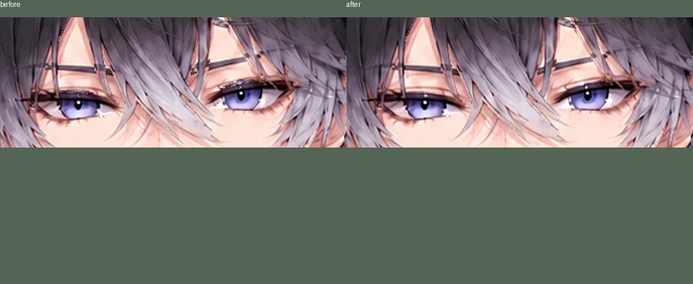
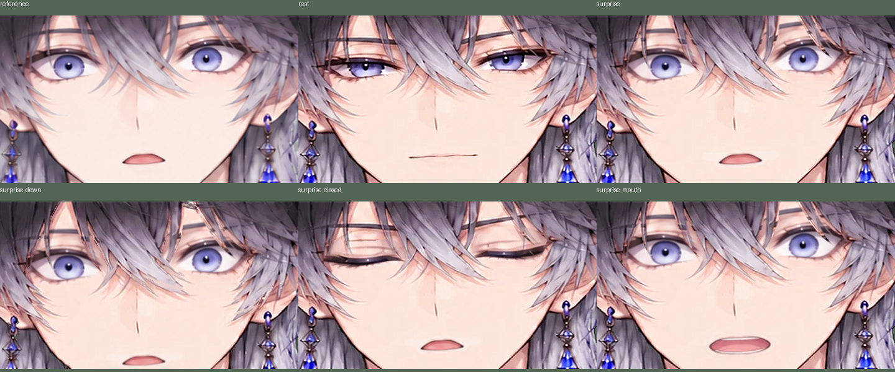
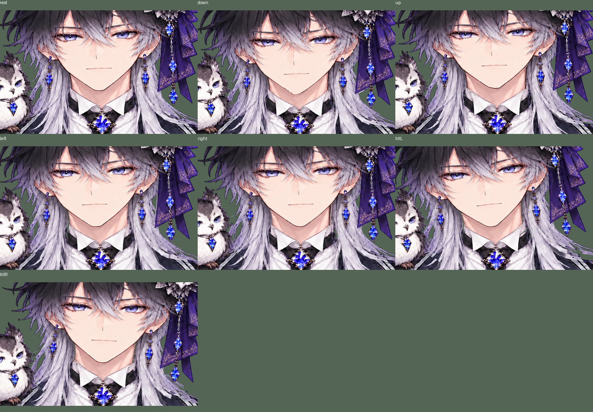

# 下向きの眉と、手動の驚き顔

下向き-10度の眉/まぶたの汚れは、長髪の寒色抽出が目・眉の画素を髪に取り込んだことが原因。露出した表情領域を顔へ戻し、提供 hair_head_alpha.png にある前髪は保持する。tools/refine_details.py で再生成する。

ユーザー提供ZIPのPNGは samples/surprised_ref.png に元ファイルのまま保存した。1145×1374のRGB画像で市松背景があるため、背景ごと使わず目・眉・口の差分だけを使う。頭・髪・服・フクロウを別の絵へ差し替えない。

- 2、または「驚き」ボタン：驚き顔の切替。
- 1：笑顔へ切替。驚き顔と同時には使わない。
- 0、真顔ボタン、リセット：表情を解除。
- 驚き顔でも瞬き可能。驚き目を既存の閉眼段階へ短く戻して閉じる。
- 驚き口は無発話時のみ。話すと従来のEの口を連続開閉する。

回転範囲は左右±5度、上+5度/下-10度、首かしげ±5度を維持。新しい3Dモデルを生成したものではなく、元絵を奥行き付きで変形する。カメラは較正姿勢からの3D姿勢行列、移動は別のBodyX/Yを使う。

検証：Python20件（リポジトリと単一HTMLの実ブラウザ2件を含む）、Node10件、失敗/スキップなし。新しいブラウザ確認は表情の排他、切替・解除・リセット、追跡中の保持、驚き時の閉眼/Eの口。従来の耳の取付点、髪の三角形、襟の透明隙間、移動と回転の独立性の閾値は変更していない。休止PSNR full34.28/face33.39/eyes32.89dB（直前34.28/33.36/32.68）。実機カメラは未確認。

実装コミットは眉修正 cdcd389 と驚き顔追加（Git履歴参照）に分割した。戻す際は対象コミットを revert し、build/export を再実行する。out/ は生成物、配布は dist/owl_prince.html。従来の物理ドライバには変更を加えていない。
